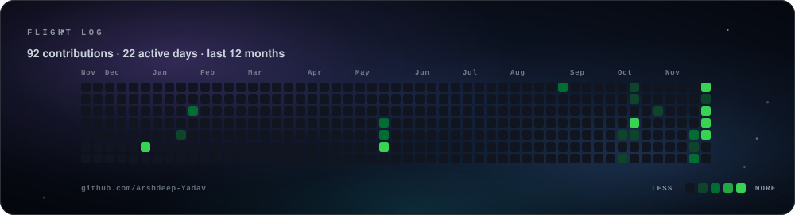

 

<h2 align="center">Moons in orbit</h2>

 
 

<h2 align="center">Constellation</h2>

<h2 align="center">Flight log</h2>

<h2 align="center">Signal me</h2>

<a href="mailto:arshdeep.yadav.work@gmail.com">Email</a> &nbsp;·&nbsp;
<a href="https://arshdeep.works">Portfolio</a> &nbsp;·&nbsp;
<a href="https://linkedin.com/in/arshdeep-yadav">LinkedIn</a> &nbsp;·&nbsp;
<a href="https://github.com/Arshdeep-Yadav">GitHub</a> &nbsp;·&nbsp;
<a href="tel:+918115237909">+91 81152 37909</a>

Hand-built in SVG — orbits, cards and this page all generated from one Python file

